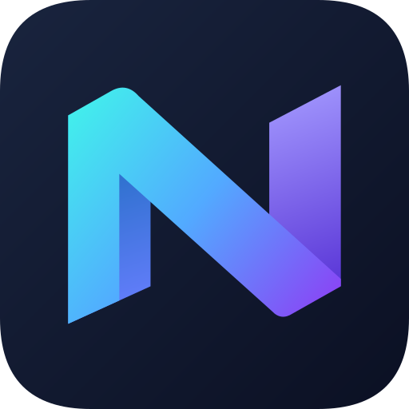

# Identidad de Nexo 0.25.0

La app usa `com.nexo.browser` como `applicationId` y namespace Kotlin, con
`versionCode = 43`. La etiqueta visible sigue siendo **Nexo Browser**.

## Instalación desde versiones anteriores

Android trata el nuevo paquete como una aplicación distinta aunque esté firmado
con la misma clave del proyecto. Nexo 0.25.0 puede coexistir con 0.24.0 y anteriores.
No reemplaza la instalación anterior ni accede automáticamente a sus datos.

- Conserva la app anterior si necesitas consultar su historial o pestañas.
- Las extensiones, configuración de IA, claves API y preferencias se configuran
  de nuevo en la nueva instalación. La memoria local de IA tampoco se transfiere.
- Los archivos descargados en carpetas compartidas del teléfono permanecen allí;
  el listado interno de descargas empieza vacío.
- Debes elegir de nuevo el navegador predeterminado y conceder los permisos que
  necesites. No desinstales el paquete anterior hasta recuperar lo que te interese.
- Las futuras versiones con `com.nexo.browser`, un código mayor y la misma firma
  podrán actualizar esta instalación conservando sus datos.

No se ha añadido un mecanismo de importación de perfiles entre aplicaciones.
La clave persistente de firma y los secrets de publicación siguen siendo los mismos.

## Integración

El namespace, las rutas de fuentes y tests, las vistas declaradas en XML y la
acción PiP usan el nuevo paquete. FileProvider deriva su autoridad de
`${applicationId}.files`, igual que el código que abre descargas.
Los puentes integrados `nexo_bridge` y `nexo_network` coinciden en sus manifests y
en Kotlin. El ID del traductor retirado conserva su valor histórico únicamente
para reconocer y eliminar esa extensión antigua si apareciera en un perfil.

## Logo



Una N plegada en cian, azul y violeta sobre fondo azul noche reemplaza el emblema
anterior. El icono adaptativo, su versión monocroma para Android 13+, la página
de inicio, el marcador de pestañas y la notificación multimedia comparten geometría.
Los trazados vectoriales evitan pixelación y el primer plano del icono adaptativo
permanece dentro del círculo seguro central de 66 dp.

La fuente de los trazados está en `tools/generate_brand_assets.cjs`. Para regenerar
los seis drawables Android y la vista previa SVG:

```bash
node tools/generate_brand_assets.cjs
```
